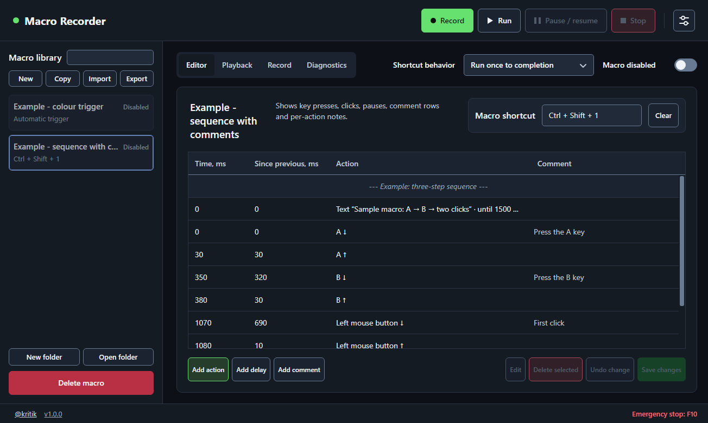
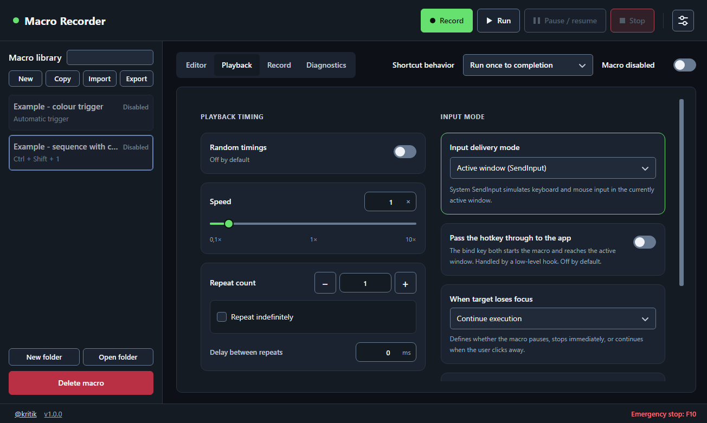
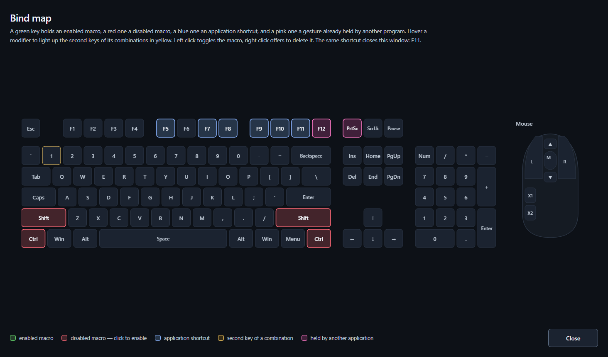

<div align="center">


# Macro Recorder

**Record keyboard, mouse and gamepad input on Windows and replay it with a native timing engine.**

[](https://github.com/smilekritik/MacroRecorder/releases/latest)
[](#build-from-source)
[](LICENSE)
[](#how-it-works)

[Download](#download) · [Quick start](#quick-start) · [Features](#features) · [Build from source](#build-from-source) · [How it works](#how-it-works) · [Project layout](#project-layout) · [User guide](docs/user-guide.md)

</div>



> [!NOTE]
> Macro Recorder works locally and does **not** bypass anti-cheat systems or application protections.
> Use it with software and games that allow automation.

## Download

Get the latest build from [Releases](https://github.com/smilekritik/MacroRecorder/releases/latest):

| File | Use it when |
| --- | --- |
| `MacroRecorder-1.0.0-win-x64-portable.zip` | You want no installation. Extract it and run `MacroRecorder.exe`. Your macros stay in a `Data` folder beside the exe |
| `MacroRecorder-Setup-1.0.0-x64.exe` | You want it installed. Run it, then run `setup.cmd` from the extracted folder. Your macros stay in `%LocalAppData%\MacroRecorder` |

The builds are not code-signed, so Windows SmartScreen or an antivirus may warn you. See [Security and false positives](#security-and-false-positives). You can compare your download with `SHA256SUMS.txt`, or [build it yourself](#build-from-source).

## Quick start

1. Press **New** and type a name for the macro.
2. Choose **Record it**, or **Build it step by step** to add actions by hand.
3. When recording, press `F7` to start and `F8` to stop, then press **Save changes**.
4. Click the **Macro shortcut** field and press the key that should start the macro.
5. Turn on **Macro enabled** and press your shortcut in any application.

`F10` is the emergency stop: it stops every macro and releases all held keys. Try new macros somewhere safe first.

The [user guide](docs/user-guide.md) covers everything else.

## Features

- **Record everything.** Keys with scan codes, mouse buttons, wheel, raw mouse movement (correct even in games that lock the cursor) and Xbox or DualShock 4 gamepads. Each source can be switched on or off per macro.
- **Or build a macro by hand.** Add key presses, clicks, text, pauses, waits, on-screen text and calls to other macros on an editable timeline, with undo, copy and paste.
- **Precise playback.** Each running macro has its own high-priority native thread, so a busy interface cannot delay it. Speed from `0.1×` to `10×`, repeats, and optional timing randomization.
- **Global shortcuts.** Bind a key, a combination, an extra mouse button or a wheel direction. A second press can stop, restart or do nothing, or the macro can run only while the key is held. Shortcuts and the emergency stop are handled natively and keep working while the interface is busy.
- **Pixel triggers.** Start a macro automatically when a point on the screen turns a given color, or make a macro wait for a color, a window or a key.
- **Two ways to deliver input.** `SendInput` to the active window, or messages posted to one chosen window so it can stay in the background.
- **Virtual gamepad.** Replay through a virtual Xbox 360 or DualShock 4 pad (ViGEmBus). The driver installers ship with the app. HidHide can optionally hide the physical pad from games.
- **Bind map.** See every shortcut on a drawn keyboard and mouse, including keys another program already holds.
- **Import and export.** Import from AutoHotkey, AutoIt, TinyTask, Razer Synapse, Jitbit and AMC. Export to AutoHotkey v2 or to a portable `.mrmacro` file. Back up the whole library to one `.mrbackup` file.
- **Diagnostics.** See the timing error of each action, run history and peak CPU, GPU and memory, and export them to CSV or JSON.
- **Desktop overlays.** Show macro status and timed prompts during playback. Move sample cards in Settings; the samples close with Settings.
- **English and Russian**, light and dark themes, tray icon, and an installer or a portable build.

| Recording and playback options | Bind map |
| --- | --- |
|  |  |

### Timing

Measured with `pnpm run bench` on one development PC. Your numbers will differ with hardware and load.

| Condition | Average error | Worst error |
| --- | --- | --- |
| Idle system | 0.003–0.006 ms | 0.01–0.5 ms |
| All CPU cores busy | 0.24–0.34 ms | 2.1–2.8 ms |

The figures show when the input call was made against when it was planned. How quickly the target application reacts is outside the app's control.

### Limitations

- Windows 10/11 x64 only.
- Games that read raw input or use anti-cheat usually ignore background delivery. Use `SendInput` with the game in front. Some titles block synthetic input entirely.
- Chromium, Electron and UWP applications also ignore background delivery.
- To send input to an elevated application, Macro Recorder must run elevated too.

## Build from source

You need:

| Tool | Notes |
| --- | --- |
| Windows 10/11 x64 | |
| [Node.js](https://nodejs.org) 24.x | Tested build environment; Corepack fetches the pinned pnpm version |
| [Rust](https://rustup.rs) stable | The default `x86_64-pc-windows-msvc` toolchain |
| [Visual Studio Build Tools](https://visualstudio.microsoft.com/downloads/) 2022 or newer | The *Desktop development with C++* workload, needed by the Rust toolchain |
| [7-Zip](https://www.7-zip.org/) x64 | Put `7z.exe` on `PATH`. The setup archive needs `7z.sfx` from the installation |

Then run:

```bat
git clone https://github.com/smilekritik/MacroRecorder.git
cd MacroRecorder
.\build.bat
```

`build.bat` installs the dependencies, compiles the native addon, bundles the app, embeds its Windows icon, packages it and checks the package. The results are in `artifacts\packages\`:

| Output | What it is |
| --- | --- |
| `MacroRecorder-portable-win-x64\MacroRecorder.exe` | Ready to run. Keeps its data in a `Data` folder beside the exe |
| `MacroRecorder-Setup-1.0.0-x64.exe` | Self-extracting setup archive. Extract it, then run `setup.cmd` from the extracted folder |
| `MacroRecorder-1.0.0-win-x64-portable.zip` | The portable build as an archive |
| `SHA256SUMS.txt` | Checksums of the files above |

`build.bat --full` also runs type checks, lint, unit, compatibility and Rust tests. These commands do not launch the application UI. UI tests require a separate, explicit command; see [CONTRIBUTING.md](CONTRIBUTING.md#optional-ui-tests).

Run these commands in a terminal opened after installing the tools. Check that `node`, `corepack`, `cargo`, and `7z` resolve on `PATH`. If Corepack is missing, install it with `npm install --global corepack`. For a non-default 7-Zip location, set `SEVENZIP_SFX_PATH` to the full path of `7z.sfx`.

Setup installs the app into `%LocalAppData%\Programs\MacroRecorder`, creates shortcuts and a Windows uninstall entry. Installed app data lives in `%LocalAppData%\MacroRecorder`. The setup archive extracts files first; extraction alone does not install the app.

To work on the code, see [CONTRIBUTING.md](CONTRIBUTING.md).

## How it works

The native engine keeps JavaScript off the input dispatch timing path:

- **Rust native addon** (`native/`): runs macros, low-level hooks, Raw Input, global shortcuts, `SendInput` and virtual gamepads, each on its own thread.
- **Electron main process** (`apps/desktop/src/main`): library, settings, windows and tray. It hands a finished plan to the native engine and takes no part in timing.
- **React interface** (`apps/desktop/src/renderer`): the windows you see, talking to the main process over a validated IPC bridge.

More detail is in [docs/architecture.md](docs/architecture.md).

## Project layout

```text
apps/desktop/       The Electron app
  src/main/         Main process (entry point: index.ts)
  src/preload/      Secure bridge between the interface and the main process
  src/renderer/     React interface (entry point: main.tsx)
  resources/        Icons and bundled driver installers
packages/           Shared TypeScript libraries
  contracts/        Data types and IPC schemas
  domain/           Macro model, timeline editing, playback rules
  storage/          Library, settings and backups on disk
  import-export/    File format importers and exporters
  localization/     Translation catalogs and helpers
native/             Rust addon: macro engine and Windows integration
scripts/            Build, packaging and package-check scripts
tests/              Cross-package test suites, fixtures and the benchmark
docs/               User guide, architecture and file formats
artifacts/          Build output (not in git)
```

## Documentation

- [User guide](docs/user-guide.md)
- [Architecture](docs/architecture.md)
- [Supported file formats](docs/formats.md)
- [The `.mrmacro` format](docs/mrmacro-format.md)
- [Changelog](CHANGELOG.md)
- [Contributing](CONTRIBUTING.md)
- [Security policy](SECURITY.md)

## Security and false positives

Macro Recorder installs low-level keyboard and mouse hooks and injects input. Keyloggers use the same Windows APIs, and the builds are not code-signed, so Microsoft Defender, SmartScreen and some antivirus engines may flag them. If that worries you, read the code in [`native/`](native/macro-recorder-native) and build the app yourself. The app stores everything locally and makes no network calls of its own.

## License

[MIT](LICENSE). Bundled third-party components are listed in [THIRD_PARTY_NOTICES.md](THIRD_PARTY_NOTICES.md).
