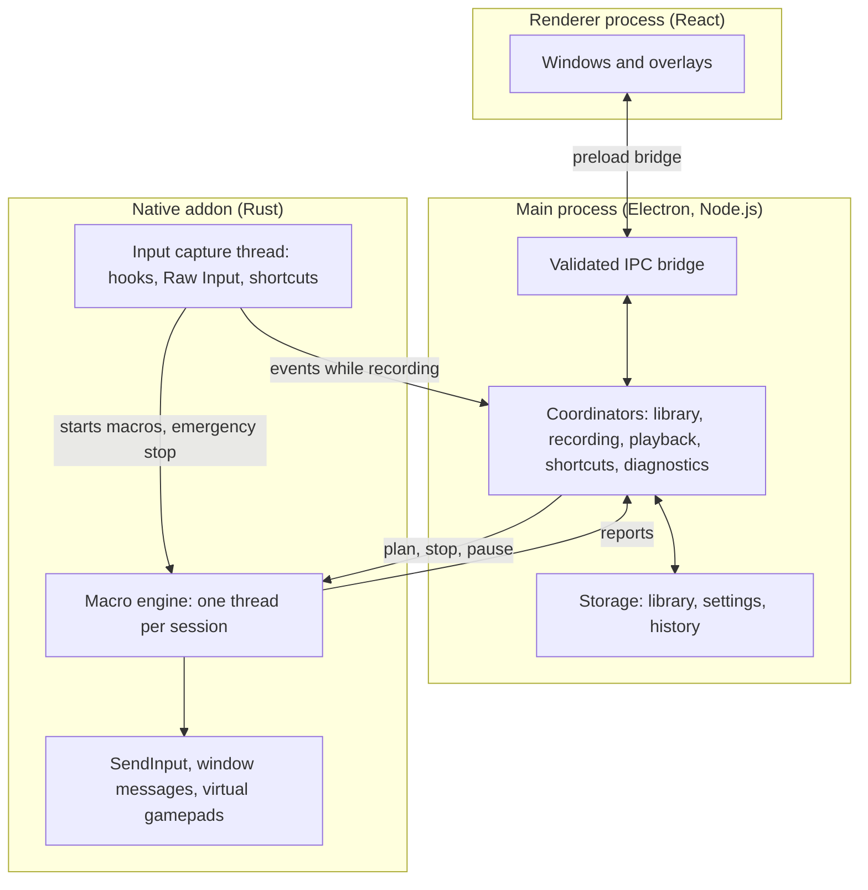

# Architecture

Macro Recorder has three layers. The main design rule is that nothing in the interface can delay a running macro.

## Layers

| Layer | Location | Responsibility |
| --- | --- | --- |
| Interface | `apps/desktop/src/renderer` | React windows, timeline editor, bind map, overlays. Has no access to Node or the native addon |
| Bridge | `apps/desktop/src/preload` | Exposes a narrow, typed API to the interface |
| Application | `apps/desktop/src/main` | Lifecycle, windows, tray and coordinators. Entry point: `index.ts`. Wiring: `application/composition-root.ts` |
| Libraries | `packages/*` | Data types and IPC schemas, macro model and timeline rules, storage, import and export, localization |
| Native | `native/macro-recorder-native` | Macro engine, hooks, Raw Input, shortcuts, input injection, gamepads, Windows services |

## Playback

1. The main process turns a macro into a finished plan (`application/adapters/engine-plan.ts`) and passes it to the native engine (`native/.../src/engine`).
2. Each session runs on its own thread with raised priority and the "Pro Audio" MMCSS class.
3. To reach a deadline, the thread sleeps on a high-resolution waitable timer and spins for the last 1.5 ms. A wake event interrupts the wait for pause and stop.
4. Reports reach JavaScript through a separate reporter thread, so a slow main process cannot hold up a session.

JavaScript takes no part in timing during production playback. The scheduler in `playback-coordinator.ts` only serves test doubles.

## Shortcuts and input capture

Hooks and shortcuts live on a dedicated capture thread with its own message loop.

- A macro shortcut starts its macro directly on that thread, and the emergency stop works the same way. Both keep working if the interface or the main process is busy.
- Physical input is forwarded to JavaScript only during a recording.
- Gamepads are polled only during a recording that has the gamepad source enabled.
- Plain keyboard shortcuts use `RegisterHotKey`. Pass-through and window-scoped shortcuts and mouse shortcuts use the low-level hooks.

## Input delivery

- **`SendInput`** goes to the active window, like a physical device.
- **Window messages** go straight to a chosen window (`WM_KEYDOWN`, `WM_CHAR`, mouse messages), so it can stay in the background. Held keys are tracked per window and released there when a macro stops.

## Storage

- A macro is a readable `<name>.macro.json` file, written atomically. Library folders are real directories.
- The default location is `%LocalAppData%\MacroRecorder`. The portable build keeps everything in `Data` beside the exe.
- The schema is versioned and older files keep loading. `tests/compatibility` guards this.

File formats are described in [formats.md](formats.md) and [mrmacro-format.md](mrmacro-format.md).

## Build

`scripts/build-app.cjs` compiles the native addon with Cargo and bundles the main, preload and renderer code with esbuild and Tailwind into `artifacts/desktop/bundle`. `scripts/package-app.cjs` then creates the portable folder, installer and ZIP, using `scripts/package-config.json` and `scripts/setup-template.ps1`. `scripts/verify-package.cjs` checks the result.
